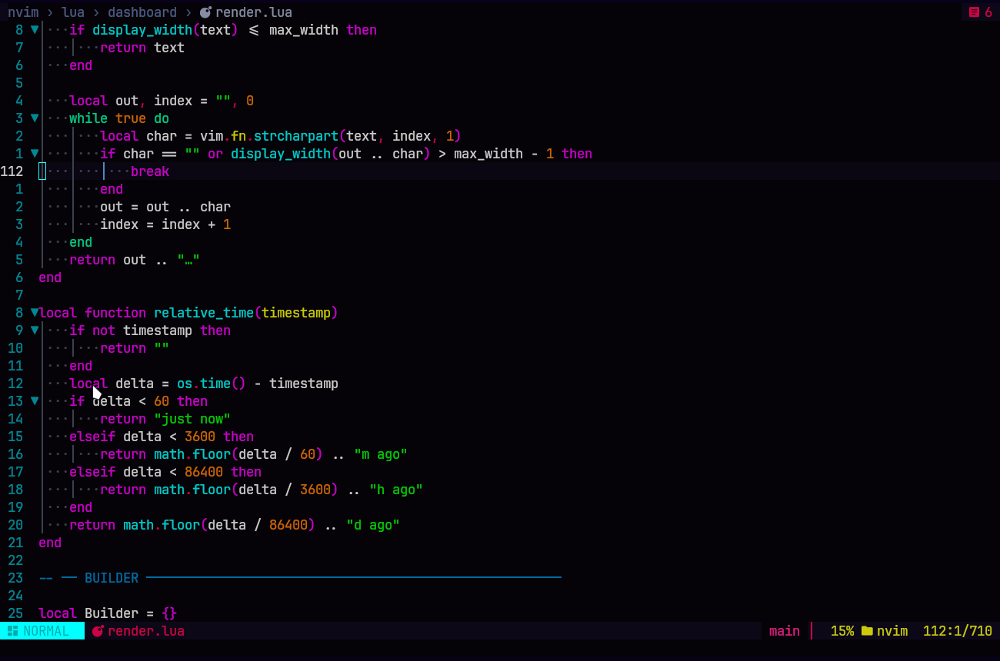
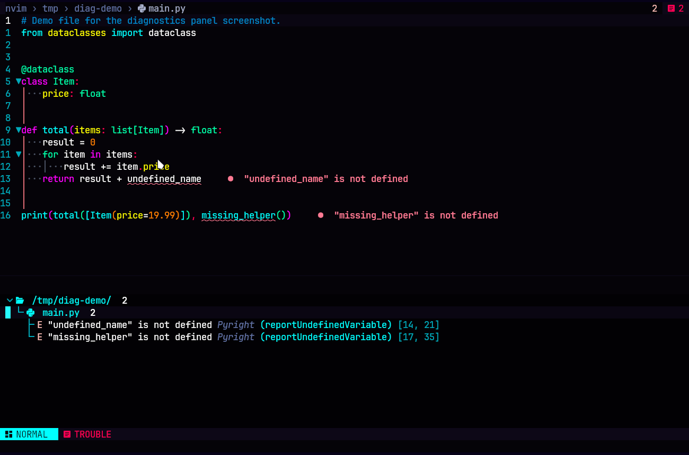

<div align="center">

# Neovim Configuration

A modular, fast-starting Neovim IDE built on NvChad v2.5 and lazy.nvim.


</div>

---

## Overview

This repository contains a complete Neovim configuration for daily software development:
LSP, completion, formatting, linting, debugging, Git, databases, HTTP requests, Markdown,
and broad language support. It is built on NvChad v2.5, uses lazy.nvim for plugin
management, and keeps application logic in small, testable Lua modules.

The configuration targets **Neovim 0.12+ on Arch Linux**. The Lua configuration is
portable, but `bootstrap.sh` uses `pacman` and is intentionally Arch-specific.

## Screenshots

<table>
  <tr>
    <td width="50%">
      
    </td>
    <td width="50%">
      
    </td>
  </tr>
  <tr>
    <td align="center"><sub>Dashboard: project status, sessions, diagnostics and launchers</sub></td>
    <td align="center"><sub>Editor: treesitter syntax, winbar, diagnostics and statusline</sub></td>
  </tr>
</table>



## Design principles

- **Lazy by default.** Plugins load on an event, command, key or filetype. Nothing loads
  speculatively, and the dashboard is available before third-party plugins.
- **Small modules, single responsibility.** LSP, formatting, linting, debugging,
  completion and the dashboard live in separate files under `lua/configs/` and
  `lua/dashboard/`.
- **Reproducible.** `lazy-lock.json` pins plugin revisions; `bootstrap.sh` installs system
  packages, plugins, Tree-sitter parsers and Mason tools.
- **Theme-derived colors.** Highlights use the active theme rather than hardcoded values,
  so switching themes does not leave orphaned colors.
- **Asynchronous by default.** External processes use `vim.system` or job callbacks; the
  editor does not block on Git, formatters or language servers.

## Requirements

| Component | Requirement |
| --- | --- |
| Neovim | 0.12 or newer |
| OS | Arch Linux (for `bootstrap.sh`) |
| Terminal | Kitty, or any terminal with true color and a Nerd Font |
| Build tools | `git`, `make`, `cargo` (avante.nvim) |
| Search | `ripgrep`, `fd` |
| Runtime | `nodejs`, `tree-sitter-cli`, `jq` (optional, for Hurl) |

Install the base toolchain on Arch:

```bash
sudo pacman -Syu --needed git base-devel ripgrep fd nodejs tree-sitter-cli cargo
```

Set your terminal font to a Nerd Font, or icons will render as missing glyphs.

## Installation

Back up an existing configuration and clone this repository:

```bash
mv ~/.config/nvim ~/.config/nvim.bak 2>/dev/null
git clone https://github.com/grubberdubber/nvim-config.git ~/.config/nvim
```

Run the bootstrap script:

```bash
~/.config/nvim/bootstrap.sh          # core toolchain
~/.config/nvim/bootstrap.sh --full   # plus Java, PHP, .NET, LaTeX and extra toolchains
```

The first run can take 10–20 minutes because Mason installs language servers and
Tree-sitter compiles parsers. The script runs a full `pacman -Syu` first, restores plugin
revisions from `lazy-lock.json`, and reports any tool it could not install.

After the first start, verify the installation:

```bash
nvim --headless "+checkhealth" +qa
```

## Architecture

```text
~/.config/nvim
├── init.lua                  # lazy.nvim bootstrap, DAP signs, module loading
├── bootstrap.sh              # Arch Linux setup (core and --full modes)
├── lazy-lock.json            # pinned plugin revisions
├── AGENTS.md                 # engineering rules for this repository
├── after/ftplugin/           # filetype-specific settings
├── ftplugin/                 # per-language overrides
├── assets/                   # screenshots used by this README
├── tests/
│   └── dashboard_spec.lua    # headless dashboard checks
└── lua/
    ├── chadrc.lua            # NvChad theme, statusline, winbar and highlights
    ├── mappings.lua          # global keymaps
    ├── options.lua           # editor options and diagnostics
    ├── autocmds.lua          # autocommands and integrations
    ├── configs/              # blink, conform, lint, LSP, DAP, panels, SQL, Hurl
    ├── dashboard/            # config, data, navigation, renderer and sessions
    ├── plugins/              # lazy.nvim specs (init, extras, markdown, api)
    └── themes/               # custom base46 themes
```

## Capabilities

### Editing and navigation

- Telescope with `fzf-native` for files, buffers, symbols, recent files and TODOs.
- Oil for directory editing, Harpoon for fast file switching, nvim-tree for a file tree.
- Treesitter syntax highlighting, text objects, folding through nvim-ufo and sticky
  context.
- Surround, autotag, multicursor, commenting, refactoring and structured split/join with
  treesj.
- Search and replace across a project with grug-far.

### Completion

`blink.cmp` provides LSP, path, snippet and buffer completion, with custom sources for
CSS selectors, HTML values, Dadbod and SQL administration. `<Tab>` selects the next item
when the menu is open and jumps over closing delimiters otherwise; `<CR>` always inserts a
newline.

### LSP, formatting and linting

- Native Neovim LSP setup through `vim.lsp.config` and `vim.lsp.enable`.
- `conform.nvim` formats on save with per-filetype formatter chains.
- `nvim-lint` runs SQLFluff with dialect awareness, Stylelint and markdownlint-cli2.
- Mason manages language servers and external tools; `mason-nvim-dap` installs debug
  adapters.

### Dashboard

The dashboard is a self-contained module, not a wrapper around a third-party start screen.
It provides:

- global recent files and recent directories;
- a project manager with pinned projects and per-project sessions;
- session save/restore, including splits and layout;
- file, grep, buffer and TODO launchers;
- Git branch, working-tree status and last commit;
- LSP diagnostic summary per project;
- `hjkl` and arrow-key navigation, number shortcuts for projects, and `?` for help.

The renderer is display-width aware and highlights interactive rows directly, without
byte-offset assumptions for multibyte icons.

### Git, debugging and data tools

- Gitsigns, Diffview and Lazygit.
- nvim-dap with a UI, virtual text, Python and C/C++/Rust adapters, and standard IDE keys.
- Dadbod and `sqls.nvim` for MySQL, MariaDB, PostgreSQL and SQLite workflows.
- Hurl for executable HTTP requests and assertions in `.hurl` files, with buffer-local
  `<leader>H*` mappings.
- Sniprun and Iron for running code and opening REPLs without leaving the editor.

### Markdown

`render-markdown.nvim` renders headings, tables, checkboxes and code blocks in the buffer;
`markdown-preview.nvim` opens a browser preview with Mermaid and KaTeX. Marksman, Prettier
and markdownlint-cli2 complete the toolchain.

## Languages

The configuration includes LSP, formatting and debugging support for:

| Area | Languages |
| --- | --- |
| Web | HTML, CSS, JavaScript, TypeScript, React/JSX, Vue, Svelte, PHP, Emmet |
| Systems | C, C++, Rust, Go, Zig, C#, Java, Kotlin, Swift, Dart, Assembly |
| Scripting | Python, Bash, Zsh, Ruby, Lua, PowerShell |
| Data | SQL (MySQL, MariaDB, PostgreSQL, SQLite, MSSQL), JSON, YAML, TOML, XML, CSV |
| Documents | Markdown, LaTeX |
| Other | Elixir, Haskell, Nim, Scala |

Language servers that require an external SDK are enabled only when their executable is
available; otherwise Neovim skips them cleanly.

## Key bindings

`<leader>` is `Space`. `which-key` lists the complete map.

### General

| Key | Action |
| --- | --- |
| `;` | Enter command-line mode |
| `-` | Open the parent directory with Oil |
| `<C-s>` | Save the current file |
| `<C-q>` | Close the current window |
| `<Tab>` / `<S-Tab>` | Next / previous buffer |
| `q` | Close auxiliary panels (Trouble, Aerial, Avante, Diffview, …) |

### Files and search

| Key | Action |
| --- | --- |
| `<leader>b` | Pick an open buffer |
| `<leader>ha` / `<leader>hm` | Harpoon: add file / open menu |
| `<leader>1`–`<leader>4` | Jump to a Harpoon file |
| `<leader>S` | Search and replace with grug-far |
| `<leader>sw` | Replace the word under the cursor |
| `<leader>ft` | Search TODO/FIXME comments |
| `<leader>gg` | Open Lazygit |

### LSP and diagnostics

| Key | Action |
| --- | --- |
| `gd` / `gD` | Go to definition / declaration |
| `gR` / `gi` | References / implementation |
| `K` | Hover documentation |
| `<leader>ca` | Code actions |
| `<leader>rn` | Rename symbol |
| `<leader>lf` | Format buffer through LSP |
| `[d` / `]d` | Previous / next diagnostic |
| `<leader>tt` | Toggle diagnostics in Trouble |
| `<leader>ts` | Toggle document symbols |

### Debugging

| Key | Action |
| --- | --- |
| `F5` | Start or continue |
| `F9` | Toggle breakpoint |
| `F10` / `F11` / `F12` | Step over / into / out |
| `Shift+F5` | Stop |
| `<leader>B` | Conditional breakpoint |
| `<leader>du` | Toggle debugger UI |

## Themes

The active theme is configured in `lua/chadrc.lua`. Custom themes under `lua/themes/`
include:

- `fluorodark` — neon fluoromachine palette with strong contrast;
- `crt_hardcore` — pure black background and maximum-saturation ANSI colors;
- `sakura_dracula` — pastel accents over a Dracula background;
- `cyberkali`, `cybermax`, `cyberneon`, `hacker`, `hellokitty`, `mrrobot`,
  `retromrobot`, `ultraneo`, `vscode_monokai` and `vscodeoscuro`.

Theme changes also update completion menus, rainbow delimiters, cursorline and dashboard
highlights.

## Validation

Run the headless dashboard suite:

```bash
nvim --headless -u init.lua -c "luafile tests/dashboard_spec.lua"
```

The suite checks layout centering, listchars handling, sessions and Trouble integration.
For a general health check:

```bash
nvim --headless "+checkhealth" +qa
```

## Troubleshooting

| Symptom | Resolution |
| --- | --- |
| Icons appear as boxes | Set the terminal font to a Nerd Font |
| `node` fails after a partial upgrade | Run `sudo pacman -Syu` |
| Avante reports a missing module | Run `:Lazy build avante.nvim`; ensure `mega.cmdparse` is installed |
| Markdown preview does not open | `cd ~/.local/share/nvim/lazy/markdown-preview.nvim/app && npm install` |
| A language server is missing | Open `:Mason`, install it, then restart Neovim |
| Formatter or linter not found | Install the executable through Mason or `pacman` |

Use `:checkhealth`, `:Lazy` and `:Mason` to inspect the current state.

## Contributing

Changes should preserve existing behavior, keep the diff focused, and justify any new
plugin. Run the dashboard suite and `stylua --check` before opening a pull request.

## License

Released into the public domain under the Unlicense. See [LICENSE](LICENSE).
