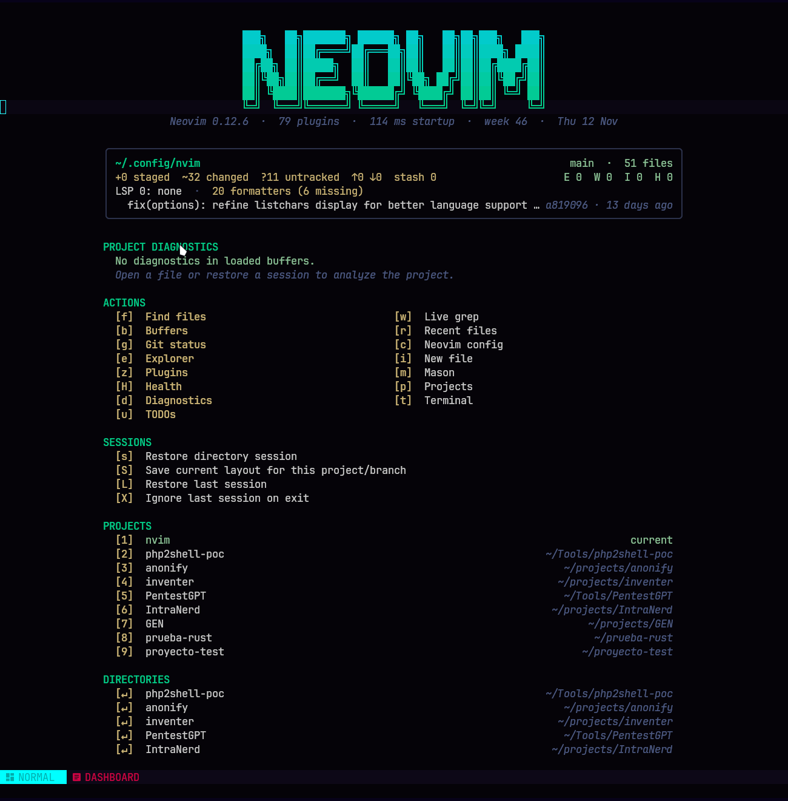
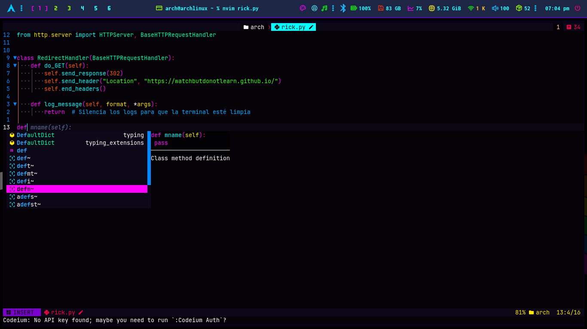

<div align="center">

# nvim-config

**A fast, modular Neovim IDE for daily software development.**

NvChad v2.5 · lazy.nvim · Neovim 0.12+ · Arch Linux


[Quick start](#quick-start) · [What's inside](#whats-inside) · [Key bindings](#key-bindings) · [Themes](#themes) · [Validation](#validation) · [Troubleshooting](#troubleshooting)

</div>

---

## Why this configuration

- **Milliseconds, not seconds.** Plugins load on an event, command, key or
  filetype, and the start screen renders before third-party plugins are loaded.
- **One responsibility per module.** LSP, formatting, linting, debugging,
  completion, the dashboard and the AI frontends live in separate files.
- **Reproducible.** `lazy-lock.json` pins every plugin revision and
  `bootstrap.sh` installs the system packages, parsers and Mason tools.
- **Theme-derived.** Highlights come from the active palette, so switching themes
  does not leave orphaned colors behind.
- **Asynchronous where it matters.** Git, ripgrep, formatters and diagnostics run
  through `vim.system` or job callbacks; the editor never waits on them.

## Screenshots

<table>
  <tr>
    <td width="50%" align="center">
      
      <br>
      <sub><b>Dashboard</b> — projects, recent files, sessions, Git and diagnostics</sub>
    </td>
    <td width="50%" align="center">
      
      <br>
      <sub><b>Editor</b> — Treesitter, breadcrumb winbar, diagnostics and HUD</sub>
    </td>
  </tr>
</table>

<table>
  <tr>
    <td width="50%" align="center">
      
      <br>
      <sub><b>Completion</b> — blink.cmp menu with LSP documentation</sub>
    </td>
    <td width="50%" align="center">
      
      <br>
      <sub><b>Diagnostics</b> — project-wide list in Trouble</sub>
    </td>
  </tr>
</table>

## Quick start

### Requirements

| Component | Requirement |
| --- | --- |
| Neovim | 0.12.5 or newer |
| OS | Arch Linux (the Lua config is portable; `bootstrap.sh` is Arch-only) |
| Terminal | kitty with true color and a Nerd Font |
| Build tools | `git`, `make`, `cargo` (avante.nvim) |
| Tree-sitter | `tree-sitter-cli` 0.25.x (0.27 removed `--no-bindings`, used by the pinned parser build) |
| Search | `ripgrep`, `fd` |
| Runtime | `nodejs` (markdownlint, prettier), `jq` (Hurl), `tree-sitter-cli` |
| Language SDKs | Go, Rust, Zig, Elixir (`mix`), GHC/Cabal (Haskell), `libxml2` (xmllint) |
| Tests | `cargo-nextest`, pytest, Go, Vitest, JUnit 5, PHPUnit, RSpec and Flutter SDKs |

```bash
sudo pacman -Syu --needed git base-devel ripgrep fd nodejs tree-sitter-cli cargo
```

### Install

```bash
mv ~/.config/nvim ~/.config/nvim.bak 2>/dev/null
git clone https://github.com/grubberdubber/nvim-config.git ~/.config/nvim
~/.config/nvim/bootstrap.sh          # core toolchain
~/.config/nvim/bootstrap.sh --full   # plus Java, PHP, .NET, LaTeX and extra SDKs
```

The first run takes 10–20 minutes: Mason installs the language servers and
Tree-sitter compiles the parsers. The script runs a full `pacman -Syu` first,
restores plugin revisions from `lazy-lock.json`, builds avante.nvim and reports
anything it could not install.

Verify the installation:

```bash
nvim --headless "+checkhealth" +qa
```

> There is also a mirror at
> [gitlab.com/grubberdubber/nvim-config](https://gitlab.com/grubberdubber/nvim-config).

## What's inside

| Area | Tools and behavior |
| --- | --- |
| **Editing** | Treesitter highlighting, text objects, nvim-ufo folding, sticky context, surround, autotag, multicursor, commenting, refactoring and treesj |
| **Navigation** | Telescope with `fzf-native`, Oil, Harpoon, nvim-tree, grug-far, project-wide TODO search and Telescope undo history |
| **Completion** | blink.cmp (LSP, path, snippets, buffer) plus custom CSS-selector, HTML-value, Dadbod, SQL-admin and emoji sources |
| **AI** | Minuet inline suggestions on demand through NVIDIA NIM; Avante for agentic edits with NVIDIA NIM or OpenRouter |
| **LSP** | Native `vim.lsp.config` / `vim.lsp.enable`, inlay hints and code lens per client |
| **Formatting** | conform.nvim on save with per-filetype chains and LSP fallback |
| **Linting** | nvim-lint with Ruff, ShellCheck, Hadolint, Yamllint, Stylelint, SQLFluff, RuboCop, HLint and markdownlint-cli2 |
| **Debugging** | nvim-dap, DAP UI and virtual text; Python, C, C++, Rust, Go, Java and Node adapters |
| **Data** | Dadbod and `sqls.nvim` for MySQL, MariaDB, PostgreSQL and SQLite; dialect picker and SQL admin helpers |
| **HTTP** | Hurl for executable requests and assertions in `.hurl` files |
| **Markdown** | render-markdown.nvim, Markdown preview with Mermaid/KaTeX, Marksman, Prettier, markdownlint-cli2 and Harper |
| **Git** | Gitsigns, Diffview and Lazygit |
| **Testing** | Neotest with pytest, Go, cargo-nextest, Vitest, JUnit 5, PHPUnit, RSpec and Flutter adapters |
| **UI** | Breadcrumb winbar, single statusline, bottom search/selection HUD, Trouble, Aerial, Zen mode and custom themes |

### Completion and AI

blink.cmp is the only completion menu. `<Tab>` moves down the list without
inserting anything (accept with `<C-y>`), wraps from the last item to the first,
and with the menu closed it jumps over closing delimiters and advances snippets.
`<S-Tab>` moves up and wraps at the top; `<C-n>`/`<Down>` and `<C-p>`/`<Up>`
mirror it. `<CR>` is always a newline and never accepts.

Ghost text is reserved for the AI frontend:

| Key | Action |
| --- | --- |
| `<M-]>` / `<M-[>` | Request or advance / go back through Minuet suggestions |
| `<C-g>` | Accept the whole Minuet suggestion |
| `<M-a>` | Accept one line of the Minuet suggestion |
| `<C-]>` | Dismiss the suggestion |

Minuet never fires while typing: requests are explicit, and the suggestion is
dismissed as soon as blink's menu opens so the two never overlap. Set
`NVIDIA_API_KEY` for Minuet/Avante and `OPENROUTER_API_KEY` for the OpenRouter
models in Avante; secrets are read from the environment, never from the repo.

Emoji completion is limited to Markdown and gitcommit messages, needs at least
two letters after the colon (`:sm`), and completed `:shortcode:` values are
converted to their emoji. CSS selectors, HTML values, Dadbod records and SQL
administration objects come from local sources in `lua/configs/`.

### Dashboard

The start screen is a self-contained module rather than a wrapper around a
third-party dashboard:

- global recent files and recent directories;
- a project manager with pinned projects and per-project sessions;
- session save and restore, including splits and layout;
- file, grep, buffer and TODO launchers;
- Git branch, working-tree status and last commit;
- per-project LSP diagnostic summary;
- `hjkl`/arrow navigation, number shortcuts for projects and `?` for help.

It is display-width aware and paints interactive rows with extmarks, without
byte-offset assumptions around multibyte icons. `listchars` and indent guides are
disabled on the dashboard and restored when a file opens.

### Status bars and HUD

The statusline shows only mode, file, Git and position. The winbar shows the
language icon, indent style (`Sp:N`/`Tab:N`), unlabeled diagnostic counts and the
number of open file buffers. Search progress (`[3/7]`) and visual selection size
(`3 lines, 51 chars`) live in the command-line row below the bars and are
restored after `:` commands, `:w` or `:Lazy`.

## Languages

| Area | Languages |
| --- | --- |
| Web | HTML, CSS, JavaScript, TypeScript, React/JSX, Vue, Svelte, PHP, Emmet |
| Systems | C, C++, Rust, Go, Zig, C#, Java, Kotlin, Swift, Dart, Assembly |
| Scripting | Python, Bash, Zsh, Ruby, Lua, PowerShell |
| Data | SQL (MySQL, MariaDB, PostgreSQL, SQLite, MSSQL), JSON, YAML, TOML, XML, CSV |
| Documents | Markdown, LaTeX |
| Other | Elixir, Haskell, Nim, Scala |

Servers that require an external SDK (Zig, Haskell, Elixir, Swift, Flutter) are
enabled only when the executable exists, so Neovim skips them cleanly instead of
reporting a broken client. Rust uses rustaceanvim, Cargo.toml gets crates.nvim and
Flutter/Dart uses flutter-tools.nvim when the SDK is in `PATH`.

## Architecture

```text
~/.config/nvim
├── init.lua                   # bootstrap, Mason PATH, DAP signs, module loading
├── bootstrap.sh               # Arch Linux setup (core and --full modes)
├── lazy-lock.json             # pinned plugin revisions
├── AGENTS.md                  # engineering rules for this repository
├── after/ftplugin/            # filetype-specific settings applied last
├── ftplugin/                  # per-language overrides (jdtls, ...)
├── assets/                    # screenshots used by this README
├── scripts/contrast_audit.lua # WCAG contrast report for the active theme
├── tests/                     # headless suites (dashboard, completion, tags, saves, Mason)
└── lua/
    ├── chadrc.lua             # theme, statusline, winbar, global highlights
    ├── mappings.lua           # global keymaps
    ├── options.lua            # editor options, diagnostics, listchars
    ├── autocmds.lua           # autocommands and integrations
    ├── configs/               # blink, conform, lint, LSP, DAP, SQL, AI, HUD...
    ├── dashboard/             # config, data, navigation, renderer, sessions
    ├── plugins/               # lazy.nvim specs (init, ai, api, extras, languages, ...)
    └── themes/                # custom base46 themes
```

Each file under `lua/plugins/` is a lazy.nvim import; `init.lua` holds the core
editor specs and `ai.lua`, `api.lua`, `extras.lua`, `languages.lua`,
`markdown.lua`, `testing.lua` and `development.lua` keep the rest focused.

## Key bindings

`<leader>` is `Space`; `which-key` lists the complete map, `<leader>fk`
fuzzy-searches it with Telescope, and `<leader>ch` opens NvChad's cheatsheet.

### General

| Key | Action |
| --- | --- |
| `;` | Enter command-line mode |
| `-` | Open the parent directory with Oil |
| `<C-s>` | Save the current file |
| `<C-q>` | Close the current window |
| `<Tab>` / `<S-Tab>` | Next / previous buffer (outside the completion menu) |
| `q` | Close auxiliary panels (Trouble, Aerial, Avante, Diffview, ...) |

### Files and search

| Key | Action |
| --- | --- |
| `<leader>b` | Pick an open buffer |
| `<leader>ha` / `<leader>hm` | Harpoon: add file / open menu |
| `<leader>1`–`<leader>4` | Jump to a Harpoon file |
| `<leader>S` | Search and replace with grug-far |
| `<leader>sw` | Replace the word under the cursor |
| `<leader>ft` | Search TODO/FIXME comments |
| `<leader>gg` | Open Lazygit |
| `<leader>su` | Browse the undo history with Telescope |

### LSP and diagnostics

| Key | Action |
| --- | --- |
| `gd` / `gD` | Go to definition / declaration |
| `gR` / `gi` | References / implementation |
| `K` | Hover documentation |
| `<leader>ca` | Code actions |
| `<leader>rn` | Rename symbol |
| `<leader>lf` | Format buffer through LSP |
| `[d` / `]d` | Previous / next diagnostic |
| `<leader>tt` | Toggle diagnostics in Trouble |
| `<leader>ts` | Toggle document symbols |
| `<leader>ui` | Toggle inlay hints |
| `<leader>uC` | Toggle code lens |
| `<leader>uh` | Toggle Harper grammar checker |

### Debugging and tests

| Key | Action |
| --- | --- |
| `F5` | Start or continue |
| `F9` | Toggle breakpoint |
| `F10` / `F11` / `F12` | Step over / into / out |
| `Shift+F5` | Stop |
| `<leader>B` | Conditional breakpoint |
| `<leader>du` | Toggle debugger UI |
| `<leader>Tt` / `<leader>Tf` | Run the nearest test / the current file |
| `<leader>Tl` / `<leader>Td` | Re-run the last test / debug the nearest test |
| `<leader>Ts` / `<leader>To` | Toggle the test summary / open the output |
| `<leader>Tx` | Stop the current test run |

## Themes

The active theme is set in `lua/chadrc.lua`. Custom palettes under `lua/themes/`:

| Theme | Character |
| --- | --- |
| `fluorodark` | Neon fluoromachine palette with strong contrast |
| `crt_hardcore` | Pure black background and maximum-saturation ANSI colors |
| `sakura_dracula` | Pastel accents over a Dracula background |
| `cyberkali`, `cybermax`, `cyberneon` | Cyberpunk palettes with different accent temperatures |
| `hacker`, `mrrobot`, `retromrobot` | Terminal and retro-inspired schemes |
| `hellokitty`, `ultraneo` | Soft pastel and light-accent variants |
| `vscode_monokai`, `vscodeoscuro` | VS Code-inspired dark palettes |

Theme switches also update the statusline, winbar, completion menu, rainbow
delimiters, cursorline and dashboard. `scripts/contrast_audit.lua` reports the
WCAG ratios of the loaded highlights without changing any color.

## Performance

Measured on this machine (Neovim 0.12.6, Arch Linux, warm cache):

```text
headless startup: ~53–56 ms (median of 5 runs)
```

Treesitter highlighting and Aerial stay eager because they must be ready for
any buffer; everything else (telescope, blink, LSP, DAP, Neotest, Avante and the
language extras) loads on its first event, command or key. Mason binaries are
checked for the executable bit without spawning `chmod` unless something is
actually broken, and the dashboard is drawn by the in-repo renderer before any
language tooling starts.

To profile your own machine:

```bash
nvim --headless --startuptime /tmp/startup.log +qa
sort -k2 -rn /tmp/startup.log | head -20
```

## Validation

The repository ships six headless suites plus a Lua syntax and formatting
check, all run in CI:

```bash
for spec in tests/*_spec.lua; do
  nvim --headless -u init.lua -c "luafile $spec"
done
npx --yes @johnnymorganz/stylua-bin@latest --check init.lua lua tests
nvim --headless -u NONE -c "lua for _, f in ipairs(vim.fn.glob('lua/**/*.lua', false, true)) do assert(loadfile(f), f) end" -c "qa"
```

The suites cover dashboard layout and state, per-language class/id detection,
malformed-tag ranges (HTML, XML, JSX and SVG), the save-time cleanup rules, the
Mason executable-bit fixer and the language tooling matrix (formatters,
linters and LSP configs). CI also lints the Markdown docs and runs
ShellCheck on `bootstrap.sh`. For a full health check:

```bash
nvim --headless "+checkhealth" +qa
nvim --headless -u init.lua "+lua dofile('scripts/contrast_audit.lua')" +qa
```

## Troubleshooting

| Symptom | Resolution |
| --- | --- |
| Icons render as boxes | Set the terminal font to a Nerd Font |
| `node` fails after a partial upgrade | Run `sudo pacman -Syu` |
| Avante reports a missing module | Run `:Lazy build avante.nvim`; ensure `mega.cmdparse` is installed |
| Markdown preview does not open | `cd ~/.local/share/nvim/lazy/markdown-preview.nvim/app && npm install` |
| A language server is missing | Open `:Mason`, install it, then restart Neovim |
| Formatter or linter not found | Install it through Mason or `pacman`; see `:ConformInfo` |
| Minuet does not suggest anything | Export `NVIDIA_API_KEY` and press `<M-]>`; requests are never automatic |

## Contributing

Changes should preserve existing behavior, keep the diff focused and justify any
new plugin. Run the dashboard suite, the Lua syntax check and `stylua --check`
before opening a pull request. Repository conventions for agents and humans live
in [AGENTS.md](AGENTS.md).

## License

Released into the public domain under the Unlicense. See [LICENSE](LICENSE).
